<!-- ═══════════════════════════════════════════════ -->
<!--        PREMIUM DYNAMIC HERO BANNER (SVG)       -->
<!-- ═══════════════════════════════════════════════ -->

<div align="center">
  <picture>
    <source media="(prefers-color-scheme: dark)" srcset="./dark.svg">
    <source media="(prefers-color-scheme: light)" srcset="./light.svg">
    
  </picture>
</div>

<!-- ═══════════════════════════════════════════════ -->
<!--           CLICKABLE SOCIAL CONNECTORS           -->
<!-- ═══════════════════════════════════════════════ -->

<div align="center">

  <a href="https://github.com/ERRIFI-X" target="_blank">
    
  </a>
  <a href="https://www.linkedin.com/in/abdelbasste-errifi-a4ab2b2b2" target="_blank">
    
  </a>
  <a href="mailto:Abdelbasset.errifi@gmail.com">
    
  </a>
  <a href="https://github.com/ERRIFI-X">
    
  </a>

</div>

<div align="center" style="margin-top: 6px;">

  [](mailto:Abdelbasset.errifi@gmail.com)
  [](https://github.com/ERRIFI-X)
  [](https://github.com/ERRIFI-X?tab=followers)
  [](https://github.com/ERRIFI-X?tab=repositories)

</div>

<br/>

<!-- ═══════════════════════════════════════════════ -->
<!--                   ABOUT ME                      -->
<!-- ═══════════════════════════════════════════════ -->

## 👋 About Me

<div style="background: linear-gradient(90deg, rgba(27,58,92,0.15) 0%, rgba(44,95,138,0.15) 100%); padding: 22px; border-radius: 12px; border-left: 5px solid #4A7BA7; border: 1px solid rgba(74, 123, 167, 0.25);">

I am a **Full-Stack Developer** based in **Marrakech, Morocco 🇲🇦**, trained at **ISTA NTIC Marrakech**, with hands-on enterprise software experience from my internship at **MORITSOFT S.A.R.L. A.U**.

My primary stack bridges **Laravel** on the backend and **React + TypeScript + Inertia.js** on the frontend. I build robust web architectures with clean separation of concerns, secure role-based access systems (RBAC), and smooth, reactive user experiences.

Currently, I am engineering a **multi-tenant SaaS platform for barbershop business management** (queue dispatching, automated notifications, payments, and real-time business KPIs), while actively exploring **full-stack engineering roles (CDI, Freelance, or Remote)**.

```typescript
const abdelbasste: Developer = {
  name: "Abdelbasste Errifi",
  role: "Full-Stack Developer",
  location: "Marrakech, Morocco 🇲🇦",
  coreStack: {
    backend: ["Laravel 12", "PHP 8.2+", "RESTful APIs", "Architecture MVC"],
    frontend: ["React 18", "TypeScript", "Inertia.js v2", "Tailwind CSS"],
    databases: ["PostgreSQL", "MySQL", "Eloquent ORM"],
    devOpsAndTools: ["Vite", "Docker", "Git", "GitHub Actions", "Postman", "DomPDF"]
  },
  flagshipProject: "SGAFO — Enterprise Trainer Management for OFPPT 🎓",
  currentFocus: "Scaling Multi-tenant Barbershop SaaS & High-Performance Web Apps 🚀",
  availability: "🟢 Open to Full-Stack Opportunities (On-site / Hybrid / Remote)"
};
```

</div>

<br/>


<!-- ═══════════════════════════════════════════════ -->
<!--                   TECH STACK                    -->
<!-- ═══════════════════════════════════════════════ -->

## 🛠️ Tech Stack & Tooling

<div align="center">

| Domain | Technologies & Frameworks |
| :--- | :--- |
| **Frontend Engineering** | <br/><sub>**React 18 • TypeScript • Inertia.js • Tailwind CSS • HTML5 • CSS3**</sub> |
| **Backend & Architecture** | <br/><sub>**Laravel 12 • PHP 8.2+ • Eloquent ORM • RESTful APIs • MVC**</sub> |
| **Databases & Storage** | <br/><sub>**PostgreSQL 16 • MySQL • MongoDB**</sub> |
| **DevOps, Build & Tools** | <br/><sub>**Vite • Docker • Git • GitHub Actions • Postman • DomPDF**</sub> |

</div>

<br/>

<!-- ═══════════════════════════════════════════════ -->
<!--               GITHUB ANALYTICS                  -->
<!-- ═══════════════════════════════════════════════ -->

## 📊 GitHub Analytics

<div align="center">
  <table border="0" style="border-collapse: collapse; width: 100%; max-width: 850px;">
    <tr>
      <td width="50%" align="center" style="border: none; padding: 8px;">
        
      </td>
      <td width="50%" align="center" style="border: none; padding: 8px;">
        
      </td>
    </tr>
  </table>
  <br/>
  
</div>

<br/>

<!-- ═══════════════════════════════════════════════ -->
<!--               CONTRIBUTION GRAPH                -->
<!-- ═══════════════════════════════════════════════ -->

## 🐍 Contribution Activity

<div align="center">
  
</div>

<br/>

<!-- ═══════════════════════════════════════════════ -->
<!--               CURRENTLY LEARNING                -->
<!-- ═══════════════════════════════════════════════ -->

## 🌱 Continuous Learning & Focus

<div align="center">

| ⚡ Advanced Architecture | 🚀 Performance & Scalability | ☁️ CI/CD & Cloud Infrastructure |
| :---: | :---: | :---: |
| Clean Architecture & Domain-Driven Design | Query Optimization & Advanced Caching | GitHub Actions Pipelines & Containerization |

</div>

<br/>

<!-- ═══════════════════════════════════════════════ -->
<!--                 CONNECT WITH ME                 -->
<!-- ═══════════════════════════════════════════════ -->

## 📫 Let's Connect

<div align="center">

<p style="color: #8B949E; font-size: 16px;">
  Whether you have a job opportunity, project inquiry, or just want to discuss software engineering — feel free to reach out!
</p>

<a href="mailto:Abdelbasset.errifi@gmail.com">
  
</a>
<a href="https://www.linkedin.com/in/abdelbasste-errifi-a4ab2b2b2" target="_blank">
  
</a>
<a href="https://github.com/ERRIFI-X" target="_blank">
  
</a>

</div>

<br/>

<!-- ═══════════════════════════════════════════════ -->
<!--                    FOOTER                       -->
<!-- ═══════════════════════════════════════════════ -->

<div align="center">

💡 **Random Dev Insight**


<br/><br/>

⚡ **Philosophy:** *"Write clean, maintainable code that solves real-world human problems."* 🚀

<br/>


</div>
